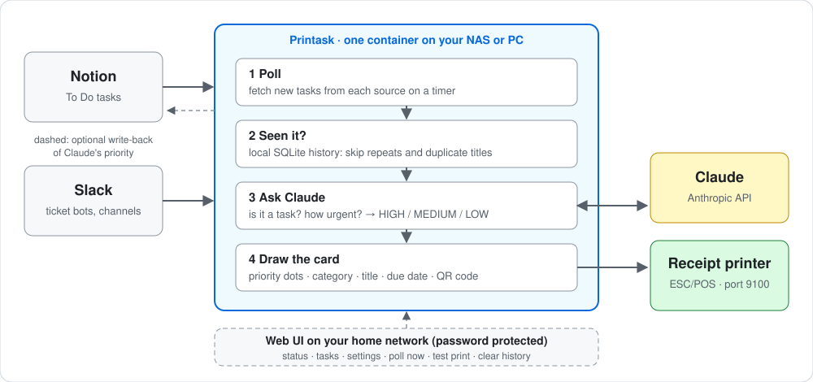
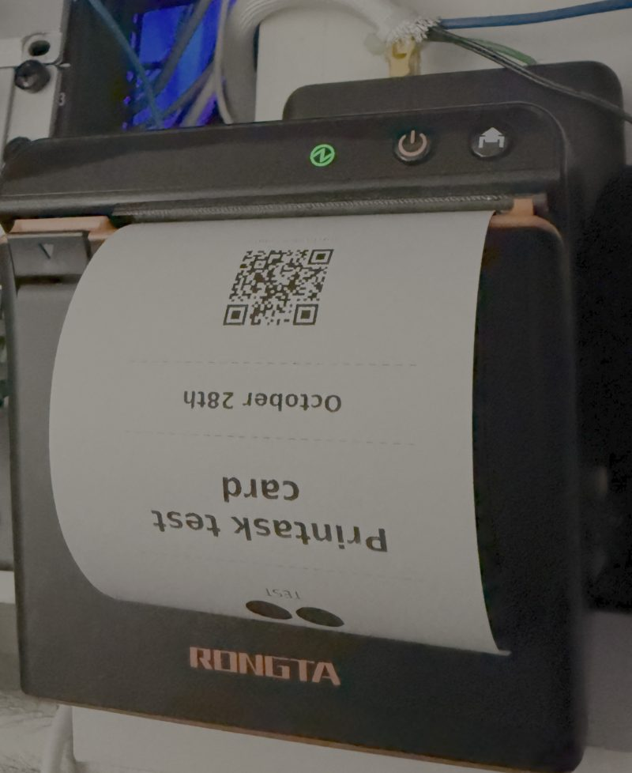

# Printask

Prints tasks as receipt cards on a network ESC/POS thermal receipt printer (tested with a Rongta ACE-H1). Tasks come from a Notion database and/or Slack channels. Claude sets each task's priority (HIGH / MEDIUM / LOW) and, for Slack, decides which messages are tasks. It polls, remembers what it has seen in a local SQLite file, skips duplicates, and runs in Docker.



## What it looks like

<table>
<tr>
<td align="center"><br><sub>A card as the printer receives it: pure black-and-white dots, so it looks like the paper</sub></td>
<td align="center"><br><sub>The test card coming out of a Rongta ACE-H1 (it feeds out upside down in this mounting)</sub></td>
</tr>
</table>

Reading a card, top to bottom:
- **Dots:** the priority. Three is HIGH, two is MEDIUM, one is LOW.
- **Small capitals under the dots:** the Notion category, if the task has one (the test card above shows `TEST`).
- **Title** in large type, then the **due date** (`Today` when there is none).
- **QR code:** scan it to open the Notion page or the Slack message the task came from.

The printer prints only black or white dots, so grey or tiny text breaks up into specks. Card text is therefore solid black. To regenerate the sample image exactly as it reaches the printer (run inside the Docker image so the font matches the real print): `docker run --rm -v "$PWD/docs/images:/out" --entrypoint python printask:latest -m simple_printer.card.sample /out/sample-card.png`.

## Why I built it this way

**What I'm trying to solve.** Our small team tasks live in Notion, and support tickets arrive in Slack from bots. A list on a screen is easy to ignore; a small printed card on the desk is not. I wanted new tasks to come out of a receipt printer on their own, with a sensible priority, without the same card printing twice, and without having to babysit it. The best part is that it was fun to use as you would hear the printer say: *'You have a new order!'*.

**Where it started.** This began as a fork of [ReceiptPrinterAgent](https://github.com/CodingWithLewis/ReceiptPrinterAgent). That version pulled JIRA emails out of Gmail through [Arcade](https://arcade.dev) (a hosted service that handles OAuth and tool calls), ran an OpenAI agent over them, and kept a hosted Turso database with OpenAI embeddings for duplicate detection. It worked, but it had a lot of moving parts and accounts, and a pile of experiments around it. I wanted a clean, small project that did one job.

**Why I dropped Arcade.**
- Arcade's role there was reaching Gmail and JIRA through a hosted middleman, driven by an agent loop. Notion and Slack are different: each is one plain HTTP call with a token. A middleman, an agent framework and one more account and key would only add ways to break.
- The agent-driven extraction was also the fragile part. The original's own history has fixes for "Max turns exceeded" errors. Here, ordinary code does the fetching, de-duplication and printing, and Claude is used only for the two judgment calls: *is this message a task?* and *how urgent is it?* Its answer is forced into a fixed shape, and if the call fails the card prints anyway with your own priority.

**Why local.** What Printask owns (the history of what it has seen, its settings) is a SQLite file on a volume on the NAS, next to the printer, in one container. There's no hosted database, no vector store and no extra service to sign up for or pay for. To be accurate, it is not air-gapped: it talks directly to Notion, Slack and Anthropic, and nothing else. Those API keys stay in the environment and never appear in the web UI, which is meant for the home-office network only.

**Trade-offs I accepted.**
- No Gmail or JIRA email ingestion. That was Arcade's job, and Slack bot posts cover my ticket case.
- Duplicate detection compares titles (ignoring case and punctuation) within a time window, not meaning. It is simpler and needs no embeddings, but a reworded duplicate will print twice.
- Network printers only, no USB.
- Claude instead of OpenAI, because that is what I wanted to use.

**Rules I kept to.** Boring code for the boring parts. The LLM never blocks printing. Failing safe: a corrupt history stops the app rather than reprinting everything, and writing back to Notion is opt-in. The card renderer comes from the original project, and its license is kept (see below).

## Setup guides

- [Synology NAS](docs/SYNOLOGY_SETUP.md) (including older Docker + Portainer; stack file: [`docker-compose.portainer.yml`](docker-compose.portainer.yml))
- [Mac](docs/MAC_SETUP.md)
- [Windows](docs/WINDOWS_SETUP.md)

> **Hardware used.** Printask runs in our **[Synology DS1825+](https://link.amazon/B0ijYOE9h)** NAS, and that is the model I tested it on. You don't need this exact model. Other x86_64 Synology models that run Docker should work, but I have only tested the DS1618+; ARM models are untested. *This is an Amazon affiliate link. If you buy through it, we earn a small commission at no extra cost to you.We earn from qualifying purchases.*

## Quick start (Docker)

```bash
cp .env.example .env
# Edit .env: NOTION_API_KEY, NOTION_DATABASE_ID, PRINTER_HOST (and ANTHROPIC_API_KEY, optional)

# One-shot test: print the current To Do tasks once and exit
docker compose run --rm -e POLL_INTERVAL_SECONDS=0 app

# Run continuously
docker compose up -d --build
docker compose logs -f app
```

Use `run --rm` for the one-shot test, not `up`: with `restart: unless-stopped` a container that exits after one run is restarted repeatedly.

The server must be able to reach `PRINTER_HOST:9100` (same LAN, or a VPN). USB printers are not supported.

**Printer compatibility.** Tested with a **Rongta ACE-H1** on its network port. Any ESC/POS receipt printer that accepts raw print jobs on a TCP port (usually 9100) should work. Printask renders the card as a 512-pixel-wide image and talks to the printer using the generic Epson `TM-T88V` profile; both are fixed in the code today and are not settings. They worked on the ACE-H1, and other models may need a different width or profile (`simple_printer/printing.py` and `simple_printer/card/image_generator.py`). Use **Print test card** on the Dashboard to check a new printer before relying on it.

## Notion setup

1. Create an internal integration at [notion.so/my-integrations](https://www.notion.so/my-integrations) and copy its token into `NOTION_API_KEY`.
2. Open your tasks database, choose **Connections** and add the integration.
3. Copy the database ID into `NOTION_DATABASE_ID` (the 32-character ID in the database URL, before `?v=`).
4. Give the database these properties. **Names must match exactly** (the check is case-sensitive; a property called `Select` or `priority` is not read):

| Property | Type | Required | Used for |
|---|---|---|---|
| `Name` (any title property) | title | yes | Card title |
| `Status` | select or status | yes | Only `To Do` / `To-do` / `Not started` tasks print |
| `Priority` | select: `High`, `Medium`, `Low` | no | Your starting priority. Claude can **override it up or down** on the printed card. Notion is only changed if you turn on `NOTION_WRITE_BACK_PRIORITY`. See "How priority is decided" |
| `Category` | select (or multi-select) | no | Printed in small capitals under the priority dots; also given to Claude as context. Any option names work (e.g. Work, Personal, Finance, Health) |
| `Due Date` | date | no | Printed on the card (date only; a time is ignored). Empty prints "Today" |

Other properties (such as `URL` or `Date Created`) are ignored. The QR code always links to the Notion page.

A sample task to create from a template:

| Name | Status | Priority | Category | Due Date |
|---|---|---|---|---|
| Pay the electricity bill | To Do | High | Finance | 2026-11-01 |

To get a "new task" template in Notion, open the database, click the arrow beside **New**, choose **New template**, and pre-fill Status = `To Do`. Printing the category can be switched off with the `SHOW_CATEGORY` setting.

## Security notes

**In place:** the web UI needs a password (compared in constant time, with a lockout after repeated failures), uses a login cookie that is HttpOnly and SameSite=Strict, a token on every form, and escapes all output. API keys and tokens live only in the environment: they are never shown in the UI, never accepted by the settings form and never written to the settings file. All database queries use parameters. Slack and Notion text is treated as untrusted: Claude's answer is forced into a fixed structure, Slack cards are capped per poll, and writing to Notion is opt-in and limited to the `Priority` of a page that came from Notion. The container runs as a non-root user, and a bad request can't hang the UI.

**Not in place, so you know what you're relying on:**
- The web UI is plain HTTP: the password and login cookie cross your network unencrypted. Keep it on your home network and never forward its port to the internet.
- The lockout is global, so someone on your network who keeps guessing can lock you out for a minute at a time.
- Dependencies are lower-bounded, not pinned, and there is no automated dependency or image scanning in CI.
- Nobody outside this project has reviewed the code.

**Last checked 2026-10-27:** a scan of the whole git history for secrets (none found), `pip-audit` on the dependencies (no known vulnerabilities), the Bandit static analyzer (the only findings were intended behavior such as listening on all interfaces inside the container, SQL text built from fixed constants, and font fallbacks), and manual probing of the web server with malformed requests, which found and fixed two hang bugs.

## Slack setup (optional)

1. Create an app at [api.slack.com/apps](https://api.slack.com/apps) (**Create New App → From scratch**) in your workspace.
2. Under **OAuth & Permissions → Bot Token Scopes**, add `channels:history` (public channels) and `groups:history` (private channels).
3. **Install to Workspace** and copy the **Bot User OAuth Token** (`xoxb-...`) into `SLACK_BOT_TOKEN`.
4. In each channel you want watched, run `/invite @your-app-name`. Without this, Slack returns `not_in_channel`.
5. Get each channel's ID (channel name → **About**, at the bottom; it starts with `C`) and put them, comma-separated, in `SLACK_CHANNEL_IDS`.

How messages become tasks is set by `SLACK_TASK_MODE`, so you can change it later without code changes:
- `claude` (default): Claude reads each new message and decides whether it is actionable (a request, support ticket, bug, alert needing action) or noise (chit-chat, "deploy succeeded", already resolved). If it is a task, Claude writes a short title, sets the priority and picks up an explicit due date. One API call per new message.
- `bots`: only bot posts (ticketing and alert bots), then the normal priority check. The text comes from the message or its attachments.
- `keyword`: only messages containing `SLACK_KEYWORD`.
- `all`: every message.

Messages from the last `SLACK_LOOKBACK_HOURS` hours are considered, each is handled once, and at most `SLACK_MAX_PER_CYCLE` new ones per poll, so a busy bot can't flood the paper. A message Claude judges not to be a task is remembered and not asked about again. If the Claude call fails, the message is retried next poll (it is not printed unfiltered). Message text is untrusted: Claude is told to treat it as data, and its output is limited to a fixed structure.

Slack's rate limits for `conversations.history` depend on how the app is distributed; an app you create and use only in your own workspace is, as far as I know, not subject to the strict limits applied to marketplace apps. This has not been tested.

## Web UI (optional)

A small page for checking on the app and changing settings without redeploying. Set `UI_PORT` (e.g. `8081`) and `UI_PASSWORD` in the environment; the UI stays off unless both are set. Then open `http://<host>:8081`.

Three pages, with tabs along the top:

- **Dashboard:** which sources are running, the last poll and its counts or error, and which keys are configured (never their values). Buttons: *Poll now* (runs a poll immediately and prints new tasks), *Print test card*, and *Preview Slack*, which shows what Claude would decide about recent messages without printing or recording anything (it does use Claude, up to 10 new messages).
- **Tasks:** the latest 100 tasks seen, with source, status (`printed`, `duplicate`, `ignored`), priority, title (linked to the Notion page or Slack message) and Claude's reason. Filter by status.
- **Settings:** Slack mode, keyword, channels, lookback and per-poll cap, poll interval, duplicate window, QR codes, printing the Notion category, writing the priority back to Notion. Values are checked, saved to `SETTINGS_PATH` on the volume, and apply on the next poll. They override the environment; clear a field to go back to the environment value.

Tokens and API keys are not shown or editable in the UI: they stay in the environment. The page is protected by the shared password (a login cookie that is HttpOnly and SameSite=Strict, a token on every form, a lockout after repeated wrong passwords). It does not use HTTPS, so anyone able to watch your network traffic could read the password and the session; keep it on your home LAN and don't expose the port to the internet.

## Configuration

Required: `PRINTER_HOST`, plus at least one source: Notion (`NOTION_API_KEY` + `NOTION_DATABASE_ID`) and/or Slack (`SLACK_BOT_TOKEN` + `SLACK_CHANNEL_IDS`). `ANTHROPIC_API_KEY` is optional for Notion (without it the Notion priority is used) but required for Slack in the default `claude` mode.

| Variable | Default | Purpose |
|---|---|---|
| `PRINTER_PORT` | `9100` | Printer port |
| `SLACK_BOT_TOKEN` | unset | Slack bot token (`xoxb-...`); enables the Slack source together with `SLACK_CHANNEL_IDS` |
| `SLACK_CHANNEL_IDS` | unset | Comma-separated channel IDs (`C...`) to watch |
| `SLACK_TASK_MODE` | `claude` | `claude`: Claude decides which messages are tasks. `all`: every message. `bots`: bot posts only. `keyword`: messages containing `SLACK_KEYWORD` |
| `SLACK_KEYWORD` | unset | Trigger text for `keyword` mode (case-insensitive) |
| `SLACK_LOOKBACK_HOURS` | `24` | How far back to look for messages |
| `SLACK_MAX_PER_CYCLE` | `10` | Most new Slack messages handled per poll; the rest wait for the next one |
| `CLAUDE_MODEL` | `claude-haiku-5-5` | Model for the priority check |
| `POLL_INTERVAL_SECONDS` | `300` | Seconds between polls; `0` runs once and exits |
| `HISTORY_PATH` | `/data/history.db` | SQLite history of every task seen |
| `DEDUPE_WINDOW_DAYS` | `7` | Skip a task whose title matches one printed in the last N days; `0` disables |
| `STATE_PATH` | `/data/printed.json` | Old state file from earlier versions; imported into the history DB if present |
| `ENABLE_QR_CODES` | `true` | QR code linking to the Notion page |
| `SHOW_CATEGORY` | `true` | Print the Notion `Category` under the priority dots |
| `NOTION_WRITE_BACK_PRIORITY` | `false` | After printing, set the Notion `Priority` to the priority on the card. Needs the integration's **Update content** capability |
| `HEALTH_PORT` | unset | If set, serves `GET /health` (compose sets 8080) |
| `LOG_LEVEL` | `INFO` | Logging level |
| `UI_PORT` | unset | Port for the web UI |
| `UI_PASSWORD` | unset | Shared password for the web UI; the UI is off without it |
| `SETTINGS_PATH` | `/data/settings.json` | Where settings edited in the UI are saved |

## How it behaves

- Each cycle fetches from every configured source (all To Do tasks from Notion following pagination, recent messages from Slack) and skips anything already in the history. One source failing doesn't stop the other. A new task whose title matches (ignoring case and punctuation) one printed in the last `DEDUPE_WINDOW_DAYS` days is logged and skipped as a duplicate, without calling Claude or printing. Otherwise Claude picks a priority, the card prints, and the task is recorded with its priority, reason, due date and time, only after a successful print. A failure on one task doesn't stop the others; it is retried next cycle.
- The duplicate check works across sources: a ticket already printed from Notion is not printed again from Slack with the same title.
- The window means a recurring task you re-create ("Pay rent") still prints once the window has passed. Untitled pages are never treated as duplicates.
- If Claude is unreachable, returns something invalid, or `ANTHROPIC_API_KEY` is missing, the card prints with the Notion priority (MEDIUM if unset).
- The history is a SQLite file on the `printer-data` Docker volume, so restarts don't reprint. `docker compose down -v` deletes it and reprints everything. A corrupt history or state file stops the app rather than reprinting everything.
- An existing `printed.json` from an earlier version is imported automatically on first start, so upgrading doesn't reprint old tasks. Afterwards the file is renamed to `printed.json.imported`, so clearing the history is not undone by a restart.
- See what has been seen: `docker exec <container> python -m simple_printer.history 20` (status, priority, title, page ID for the last 20).

## Clearing the history

The history is what stops tasks printing twice, so clearing it makes Printask forget them. **Notion tasks that are still `To Do`, and Slack messages inside the lookback window, are handled again and may print again.** Slack messages Claude ignored are re-checked by Claude, which uses API calls. Clear only what you need.

**In the web UI:** open the **Tasks** tab and use **Clear history** at the bottom. Choose what to clear, then **Review...** shows how many rows would be deleted and asks for confirmation before anything is removed.

| Choice | Deletes | Typical use |
|---|---|---|
| Ignored messages and duplicates (default) | Rows with status `ignored` or `duplicate` | Tidy the list; printed tasks stay remembered, so nothing reprints |
| Ignored messages only | `ignored` rows | Make Claude re-judge recent Slack messages, for example after changing the Slack mode |
| Duplicates only | `duplicate` rows | |
| Everything older than N days | Rows of every status older than N days | Keep the database small |
| Everything | All rows | Start over; tasks still `To Do` print again |

**From the command line** (works without the UI; replace the container name if yours differs):
```bash
# everything
docker exec printask-app-1 python -c "import sqlite3; c=sqlite3.connect('/data/history.db'); c.execute('DELETE FROM tasks'); c.commit()"
# only ignored and duplicate rows
docker exec printask-app-1 python -c "import sqlite3; c=sqlite3.connect('/data/history.db'); c.execute(\"DELETE FROM tasks WHERE status IN ('ignored','duplicate')\"); c.commit()"
# one task, so it prints again (match part of the title)
docker exec printask-app-1 python -c "import sqlite3; c=sqlite3.connect('/data/history.db'); c.execute(\"DELETE FROM tasks WHERE title LIKE '%rent%'\"); c.commit()"
```
On a Synology, add `sudo`. To start completely fresh, including saved UI settings, delete the `printer-data` volume.

## How priority is decided

Every card is HIGH, MEDIUM or LOW. Where the value comes from depends on the source and on whether `ANTHROPIC_API_KEY` is set:

| Source | Claude key set and working | No key, or the Claude call fails |
|---|---|---|
| **Notion** | Claude picks the priority from the title, the Notion Priority, the due date and today's date, and is told an overdue task must be HIGH | The Notion **Priority** select: `High`, `Medium` or `Low` (any capitalization). Anything else, such as "Urgent", an empty value or no Priority property, becomes **MEDIUM**. A warning is logged and the Tasks tab shows the reason `Fallback to Notion priority: ...`. Printing is never blocked |
| **Slack, `claude` mode** (default) | Claude decides whether the message is a task, then writes the title, priority and any stated due date | **No key: the app refuses to start** (`ANTHROPIC_API_KEY is required when SLACK_TASK_MODE=claude`), because guessing would print every chat message. **Key set but the call fails:** the message is not printed and is retried on the next poll |
| **Slack, `bots` / `keyword` / `all` mode** | Claude sets the priority from the message's first line | Slack messages have no Notion priority, so every card is **MEDIUM** |

### Claude can override your Notion priority

The priority you set in Notion is a starting point, not the final word. With the Anthropic key set, Claude can **raise or lower it**: a task you marked Low can print as HIGH (for example when it is overdue or describes an outage), and a High one can print as MEDIUM or LOW if it looks minor. Claude is told to keep your priority unless the title or due date clearly justify a change, so most cards agree with Notion. The category is a small nudge.

- **By default Notion is not changed.** Printask only reads your database. The override affects the printed card and Printask's own history, so Notion can say Low while the card shows three dots.
- **Optional write-back:** turn on `NOTION_WRITE_BACK_PRIORITY` (environment variable, or **Settings** in the web UI; default **off**) and, after a card prints, the Notion `Priority` is set to the priority that printed. Details below.
- **See why it changed:** the **Tasks** tab shows the priority that printed and Claude's one-sentence reason.
- **Want your priority used as-is?** Remove `ANTHROPIC_API_KEY` for Notion-only use (the Slack `claude` mode needs the key). There is no setting that keeps Claude but ignores its priority on the card.

### Writing the priority back to Notion (optional)

With `NOTION_WRITE_BACK_PRIORITY=true`, Printask updates the page's `Priority` select to match the card, so Notion and the printout agree. Be aware of what that means:

- **It overwrites what you set by hand.** A task you marked Low becomes High in Notion if Claude raised it. Leave it off if you want Notion to stay purely your own record.
- **The integration needs edit access.** In [notion.so/my-integrations](https://www.notion.so/my-integrations), open your integration, go to **Capabilities** and enable **Update content**. Until then it can only read, and write-back fails with a 403 (the card still prints; look for `Write-back ... failed` in the logs and `writeback_failed` in the Dashboard's last-poll counts).
- **Only real decisions are written.** Nothing is written when Claude agrees with your priority, when the card failed to print, when the task was skipped as a duplicate, or when Claude wasn't used (no key or an API error, where the card just uses your priority). An empty Priority is filled in with Claude's choice.
- **The option names must match.** Printask writes `High`, `Medium` or `Low`. If your `Priority` select uses other option names, Notion would add new options with those names.
- Notion only. Slack messages have nothing to write back to.

What you lose without the key: nothing is escalated. An overdue task marked Low in Notion prints as LOW, and an outage report in Slack can't be told apart from routine messages. The "overdue means HIGH" rule is part of Claude's instructions, not a hard-coded rule, so it can occasionally be missed even with a key.

## Run without Docker

```bash
python3 -m venv venv && source venv/bin/activate    # Windows: see docs/WINDOWS_SETUP.md
pip install -r requirements.txt
export HISTORY_PATH=./history.db
python -m simple_printer
pytest tests/
```

## Layout

- `simple_printer/`: `notion_source.py` and `slack_source.py` (fetch), `history.py` (SQLite history, duplicate check), `settings.py`, `status.py`, `actions.py` and `webui.py` (web UI), `priority.py` (Claude priority check and chat-message classification), `printing.py` (network print), `app.py` (poll loop, state file), `card/` (card image and QR rendering)
- `tests/`: offline pytest tests with mocked Notion, Anthropic and printer
- `Dockerfile`, `docker-compose.yml`, `.env.example`

## License

MIT, see [LICENSE](LICENSE). The card renderer in `simple_printer/card/` derives from [ReceiptPrinterAgent](https://github.com/CodingWithLewis/ReceiptPrinterAgent).
